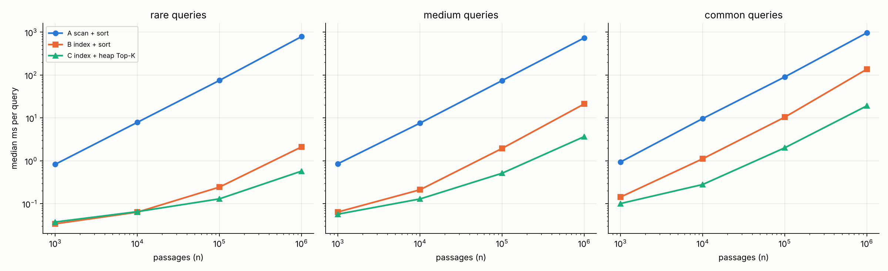
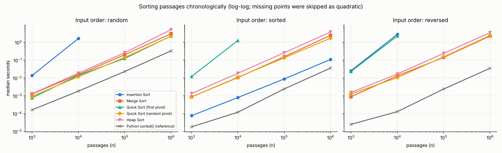

# Case-Law Research Engine — Algorithm Engineering Portfolio Project (CPS 3440)

**Summary.** Compare hand-written algorithms for sorting, look-up and Top-K keyword search on **1,000,000 passages of real U.S. Supreme Court opinions**, with measured runtime, exact comparison counts and memory, and analysis against theory. Individual project by Eya Ben Amara, Kean University, Fall 2026.

## 1–2. Problem
A law firm's research tool must (a) order authorities by date, (b) open a cited passage, and (c) find the best passages for a legal concept. Each is an algorithmic choice whose cost grows with the collection. Which algorithm should be used, and do measurements match theory?

## 3. Visualization



## 4. Dataset
Supreme Court Decisions (textacy-data v1.0; text from FindLaw, metadata from the Supreme Court Database, CC BY-NC 3.0 US): 8,417 usable decisions, 1946–2016, 360 million characters → 2,152,182 sentence-level passages, of which a seeded sample of 1,000,000 is used. Not stored in the repo; see [docs/DATASET.md](docs/DATASET.md).

## 5. Algorithms implemented (all by hand, `src/caselaw/`)
- **Sorting:** insertion, merge, quick (first pivot, random pivot), heap (+ built-in `sorted()` as labeled reference)
- **Look-up:** linear search, binary search, chaining hash table with Fibonacci hashing (+ `dict` reference)
- **Top-K retrieval:** A naive scan + sort, B inverted index + sort, C inverted index + size-K heap

## 6. Complexity summary
| Algorithm | Time | Space |
|---|---|---|
| Insertion | O(n²), O(n) sorted | O(1) |
| Merge | Θ(n log n) | O(n) |
| Quick | O(n log n) avg, O(n²) worst | O(log n) |
| Heap | Θ(n log n) | O(1) |
| Linear / Binary / Hash | O(n) / O(log n) / O(1) expected | O(1) / O(1) / O(n) |
| Retrieval A / B / C | O(nL + m log m) / O(P + m log m) / O(P + m log K) | O(m) / index / index |

(n passages, m matches, P postings scanned, K = 10.) Details: [docs/PSEUDOCODE.md](docs/PSEUDOCODE.md).

## 7. Major results (n = 1,000,000, 2-vCPU container)
- Sorting random keys: quick 2.2 s, merge 3.0 s, heap 5.1 s, `sorted()` 0.33 s; first-pivot quick sort takes 1.26 s on just 10,000 sorted keys.
- Look-up: linear 19 ms, binary 1.9 µs, own hash table 0.26 µs per query (but 7.7 s to build).
- Retrieval: rare query 568 ms (scan) → 0.125 ms (index + heap), ≈ 4,500× faster; heap beats full sort 48× for the top 10 of 185,602 matches; index costs 14.4 s and 167 MB to build.
- Measured growth matches theory (comparison counts exact: n(n−1)/2 = 31,996,000 at n = 8,000). Full tables: `results/`.

## 8. Technologies
Python 3.13 (standard library for all algorithms), matplotlib (figures), pytest (tests), GitHub Pages (site).

## 9. Installation
```bash
git clone https://github.com/benamaraeya25-hue/atl_legal_crm_algorithms
cd atl_legal_crm_algorithms
pip install -r requirements.txt
export PYTHONPATH=src            # Windows PowerShell: $env:PYTHONPATH="src"
python -m caselaw.cli download   # ~111 MB dataset
```

## 10. How to run
```bash
python -m caselaw.cli stats
python -m caselaw.cli search "equal protection" --k 5 --passages 100000
python -m caselaw.cli lookup "329 U.S. 1"
python -m caselaw.cli timeline
bash benchmarks/run_all.sh && python benchmarks/make_figures.py   # full benchmarks (about 10 min)
```
The first run builds and caches the 1M-passage corpus (a few minutes).

## 11. Testing
```bash
PYTHONPATH=src python -m pytest -q tests     # 68 tests
```

## 12. Project structure
```
src/caselaw/    data.py sorting.py lookup.py retrieval.py instrument.py cli.py
tests/          unit tests          benchmarks/  experiment scripts + run_all.sh
results/        CSV results         figures/     PNG charts
docs/           PAPER.md, PSEUDOCODE.md, DATASET.md      presentation/   slides
index.html      GitHub Pages site   CONTRIBUTIONS.md     LICENSE (MIT)
```

## 13. Contributors
Eya Ben Amara — individual project (see [CONTRIBUTIONS.md](CONTRIBUTIONS.md), including the disclosure of generative-AI assistance).

## 14. Website
https://benamaraeya25-hue.github.io/atl_legal_crm_algorithms/

## 15. Technical paper
[docs/PAPER.md](docs/PAPER.md)

## 16. Presentation
[presentation/](presentation/) (add the public link here if shared)
